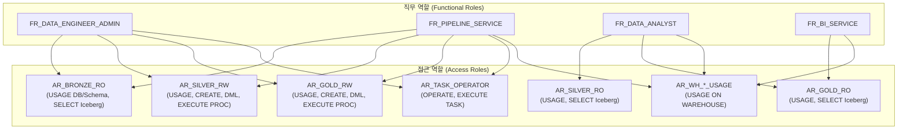
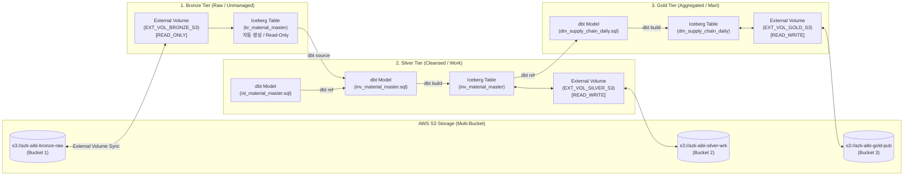

# Snowflake Iceberg Medallion Lakehouse 프로젝트 명세서 (PROJECT.md)

## 1. 프로젝트 개요 (Overview)

본 프로젝트는 **Snowflake**를 코어 데이터 플랫폼으로 활용하여, **Apache Iceberg Open Table Format**과 **AWS S3 External Volume**을 결합한 엔터프라이즈급 **Medallion Architecture (Bronze → Silver → Gold)** 데이터 레이크하우스를 구축하는 것을 목표로 합니다.

### 핵심 설계 원칙
1. **스토리지와 컴퓨팅의 완전한 분리**: 데이터는 고객 소유의 AWS S3 버킷에 Parquet/Iceberg 형식으로 영구 보관되며, Snowflake는 고성능 쿼리 및 데이터 가공 컴퓨팅 엔진으로 동작합니다.
2. **오픈 테이블 포맷 (Apache Iceberg)**: 벤더 락인을 방지하고, ACID 트랜잭션, 타임 트래블, 스키마 에볼루션을 보장하며, 외부 분석 엔진(Athena, Spark 등)과의 상호 운용성을 확보합니다.
3. **dbt Projects on Snowflake 기반 선언적 파이프라인**: 복잡한 수동 Stored Procedure 관리 및 외부 오케스트레이터(Airflow 등) 의존성을 제거하고, Snowflake 네이티브 dbt 객체(`DBT PROJECT`)와 Snowflake Tasks를 결합하여 시각적 DAG 관측성, 자동 스키마 진화(Schema Evolution), 멱등성(Idempotency) 및 무결성이 보장되는 파이프라인을 운영합니다.

---

## 2. Snowflake 환경 및 인프라 명세

### 2.1 클라우드 및 에디션/리전 구성
- **Snowflake Edition / Tier**: **Business Critical Edition** (AWS PrivateLink 사설 통신망 연동, Tri-Secret Secure, 전송/저장 데이터 고수준 암호화 지원 필수 티어).
- **클라우드 제공자**: AWS
- **배치 원칙**: Snowflake 계정과 AWS S3 버킷(Bronze, Silver, Gold)을 **동일한 AWS 리전(예: ap-northeast-2)**에 구성하여 데이터 전송 지연시간을 단축하고 불필요한 Data Egress 비용을 제거합니다.

### 2.2 가상 웨어하우스(Virtual Warehouse) 설계
워크로드의 성격에 따라 웨어하우스를 물리적으로 격리하여 리소스 경합을 방지하고 비용을 최적화합니다.

| 웨어하우스명 | 크기 | Auto-Suspend | 멀티 클러스터 | 주요 워크로드 |
| :--- | :---: | :---: | :---: | :--- |
| `WH_INGEST_XS` | X-Small | 60초 | No | Bronze 카탈로그 동기화 및 메타데이터 갱신 |
| `WH_TRANSFORM_SILVER` | Medium | 60초 | No | Silver 계층 Stored Procedure 실행 (정제/유효성검증) |
| `WH_TRANSFORM_GOLD` | Medium | 60초 | No | Gold 계층 Stored Procedure 실행 (마트 집계) |
| `WH_ANALYTICS_BI` | Medium / Large | 120초 | Yes (1~3) | BI 대시보드(Tableau, PowerBI 등) 및 분석가 쿼리 |

### 2.3 데이터베이스 및 스키마 명명 체계
계층별로 전용 데이터베이스와 스키마를 논리적·물리적으로 분리합니다.

| 레이어 | 데이터베이스명 | 스키마명 | External Volume | 설명 |
| :--- | :--- | :--- | :--- | :--- |
| **Bronze** | `COM_AZK_AIBI_RAW_MDLS` | `aibi_bronze` | `EXT_VOL_BRONZE_S3` | Fivetran/S3에서 동기화된 원천 Iceberg 테이블 (Read-Only) |
| **Silver** | `COM_AZK_AIBI_WRK` | `AIBI_SILVER` | `EXT_VOL_SILVER_S3` | 비즈니스 룰 검증, 정제 및 표준화된 테이블 (Read/Write) |
| **Gold** | `COM_AZK_AIBI_PUB` | `AIBI_GOLD` | `EXT_VOL_GOLD_S3` | 최종 비즈니스 KPI 집계 마트 테이블 (Read/Write) |
| **Admin** | `COM_AZK_MGMT_DB` | `MONITORING`, `TASKS` | - | 파이프라인 감사 로그, Event Table, 알림 연동 |

### 2.4 Snowflake Admin Group 중앙 관리 요소 (dbt 불포함 인프라 영역)
데이터 파이프라인(dbt, 일반 배치)의 권한 범위를 제한하고, 거버넌스 및 비용 통제를 위해 다음 인프라 요소는 **Snowflake Admin Group (`ACCOUNTADMIN` / `SYSADMIN`)**에서 전담 관리합니다.

1. **Warehouse (가상 웨어하우스 전담 관리)**:
   - **관리 주체**: Snowflake Admin Group.
   - **통제 범위**: 웨어하우스 생성(`CREATE WAREHOUSE`), 크기 조정(Resizing), Auto-Suspend / Auto-Resume 정책, Multi-Cluster 설정, Resource Monitor(월간 크레딧 한도 및 강제 서스펜드 정책) 설정.
   - **파이프라인/개발자 권한**: dbt 및 일반 파이프라인 역할은 웨어하우스 생성/수정 권한이 없으며, 오직 지정된 웨어하우스에 대한 `USAGE` 권한만 부여받아 쿼리를 실행합니다.
2. **Catalog & Storage (데이터 거버넌스 및 카탈로그 전담 관리)**:
   - **관리 주체**: Snowflake Admin Group.
   - **통제 범위**: Database, Schema, Catalog Integration(AWS Glue, Snowflake Polaris, Snowflake Internal Catalog), External Volume, Storage Integration 생성 및 AWS IAM 보안 연동.
   - **파이프라인/개발자 권한**: dbt 및 파이프라인은 Admin이 사전에 프로비저닝한 Catalog 및 External Volume 환경 내에서 테이블 생성/구체화(`CREATE ICEBERG TABLE`, `DML`)만 수행합니다.

---

## 3. 보안, 인증 및 인가 체계

### 3.1 사용자 및 시스템 인증 (Authentication)
1. **일반 사용자 & 데이터 분석가 (SSO Only 접근 강제)**:
   - **접속 방식**: **IdP SSO(Single Sign-On)로만 접속 가능** (아이디/패스워드 직접 로그인 차단).
   - **인증 연동**: 사내 IdP (Okta, Azure AD 등)와 연동된 **SAML 2.0 기반 SSO** 및 **SCIM** 자동 프로비저닝 적용.
   - **MFA 의무화**: IdP 차원의 조건부 액세스 및 MFA(다중 요소 인증) 필수 통과.
   - **보안 정책**: Snowflake `AUTHENTICATION POLICY`를 통해 일반 유저의 패스워드 인증 방식을 원천 비활성화.
2. **CI/CD 파이프라인 (GitHub Actions)**:
   - 비밀번호/PAT 없이 **GitHub Actions OIDC (Workload Identity Federation)** 기반 인증 연동.
3. **배치 및 시스템 연동 계정**:
   - **RSA 2048-bit Key-pair 인증** (`JWT Token`)을 사용하며 비밀번호 로그인 차단.

### 3.2 네트워크 인가 및 엔터프라이즈 티어 통제 (AWS PrivateLink & VPN 단말 제한)
- **Snowflake Tier & 연결 구조 (AWS PrivateLink)**:
  - Snowflake **Business Critical Edition**의 **AWS PrivateLink** 기능을 적용하여 공용 인터넷(Public Internet) 노출을 완전히 차단.
  - 전용 사설 엔드포인트 URL(`https://<account_name>.<region>.privatelink.snowflakecomputing.com`)을 통해서만 통신.
- **VPN 인가 특정 PC(단말기)만 접속 허용 (3중 방어 체계)**:
  1. **네트워크 레벨 (Snowflake Network Policy)**:
     - Snowflake `NETWORK POLICY`의 `ALLOWED_IP_LIST`에 사내 승인된 **전용 VPN 게이트웨이의 고정 IP 대역만 등록**하여, VPN 터널을 경유하지 않은 모든 접근 차단.
  2. **단말기 레벨 (Device Trust & Corporate VPN)**:
     - 사내 자산 관리 시스템(MDM / Intune / Jamf)에 등록되어 인증서(mTLS)가 설치된 **인가된 특정 업무용 PC**에만 사내 VPN 클라이언트 접속 프로파일을 배포.
     - 비인가 개인 단말(BYOD)이나 승인되지 않은 PC에서의 VPN 접속 원천 차단.
  3. **인증 레벨 (IdP Conditional Access & SSO)**:
     - 사내 IdP(Azure AD, Okta 등)의 조건부 액세스 정책(Conditional Access Policy)을 구성하여, **"인가된 특정 PC(Compliant Device) + 사내 VPN IP 대역"** 조건이 모두 충족될 때만 Snowflake SSO 로그인이 성공하도록 통제.

### 3.3 Snowflake 내 권한 관리 체계 (RBAC: 2-Tier Architecture)

접근 권한을 오브젝트 중심의 **Access Role (접근 역할)**과 업무 중심의 **Functional Role (직무 역할)**로 분리합니다.



#### 세부 권한 설정
- **Snowflake Admin Group (`ACCOUNTADMIN` / `SYSADMIN`)**:
  - `CREATE WAREHOUSE`, `MODIFY WAREHOUSE`, `CREATE RESOURCE MONITOR` 등 모든 웨어하우스 인프라 제어 전담.
  - `CREATE DATABASE`, `CREATE EXTERNAL VOLUME`, `CREATE CATALOG INTEGRATION` 등 카탈로그 및 스토리지 통합 전담.
  - 일반 개발자/파이프라인 역할에는 상기 생성 권한을 일체 위임하지 않음.
- **Bronze (`AR_BRONZE_RO`)**:
  - `USAGE ON DATABASE COM_AZK_AIBI_RAW_MDLS`
  - `USAGE ON SCHEMA COM_AZK_AIBI_RAW_MDLS."aibi_bronze"`
  - `SELECT ON ALL/FUTURE ICEBERG TABLES IN SCHEMA COM_AZK_AIBI_RAW_MDLS."aibi_bronze"`
  - **DML(INSERT/UPDATE/DELETE/ALTER) 권한 부여 원천 차단 (Read-Only 보장)**
- **Silver (`AR_SILVER_RW`)**:
  - `USAGE ON DATABASE COM_AZK_AIBI_WRK`
  - `USAGE, CREATE ICEBERG TABLE, CREATE PROCEDURE, CREATE TASK ON SCHEMA COM_AZK_AIBI_WRK.AIBI_SILVER`
  - `ALL PRIVILEGES ON ALL/FUTURE ICEBERG TABLES IN SCHEMA COM_AZK_AIBI_WRK.AIBI_SILVER`
- **Gold (`AR_GOLD_RW`)**:
  - `USAGE ON DATABASE COM_AZK_AIBI_PUB`
  - `USAGE, CREATE ICEBERG TABLE, CREATE PROCEDURE, CREATE TASK ON SCHEMA COM_AZK_AIBI_PUB.AIBI_GOLD`
  - `ALL PRIVILEGES ON ALL/FUTURE ICEBERG TABLES IN SCHEMA COM_AZK_AIBI_PUB.AIBI_GOLD`

---

## 4. Snowflake 작업 환경 및 데이터 파이프라인

### 4.1 전체 아키텍처 개요



### 4.2 AWS S3 External Volume 구성
각 계층별 독립된 S3 버킷과 IAM Role을 연동합니다.

```sql
-- 1. Bronze External Volume (Read-Only)
CREATE OR REPLACE EXTERNAL VOLUME EXT_VOL_BRONZE_S3
   STORAGE_LOCATIONS =
      (
         (
            NAME = 'ext-vol-bronze-s3'
            STORAGE_PROVIDER = 'S3'
            STORAGE_BASE_URL = 's3://azk-aibi-bronze-raw/'
            STORAGE_AWS_ROLE_ARN = 'arn:aws:iam::123456789012:role/snowflake-bronze-s3-role'
         )
      );

-- 2. Silver External Volume (Read & Write)
CREATE OR REPLACE EXTERNAL VOLUME EXT_VOL_SILVER_S3
   STORAGE_LOCATIONS =
      (
         (
            NAME = 'ext-vol-silver-s3'
            STORAGE_PROVIDER = 'S3'
            STORAGE_BASE_URL = 's3://azk-aibi-silver-wrk/'
            STORAGE_AWS_ROLE_ARN = 'arn:aws:iam::123456789012:role/snowflake-silver-s3-role'
         )
      );

-- 3. Gold External Volume (Read & Write)
CREATE OR REPLACE EXTERNAL VOLUME EXT_VOL_GOLD_S3
   STORAGE_LOCATIONS =
      (
         (
            NAME = 'ext-vol-gold-s3'
            STORAGE_PROVIDER = 'S3'
            STORAGE_BASE_URL = 's3://azk-aibi-gold-pub/'
            STORAGE_AWS_ROLE_ARN = 'arn:aws:iam::123456789012:role/snowflake-gold-s3-role'
         )
      );
```

* **AWS IAM Role 보안 신뢰 관계**:
  * `DESCRIBE EXTERNAL VOLUME <name>` 결과의 `STORAGE_AWS_IAM_USER_ARN` 및 `STORAGE_AWS_EXTERNAL_ID`를 IAM Role Trust Policy에 등록.
  * Bronze Role은 `s3:GetObject`, `s3:ListBucket`만 허용(쓰기 차단).
  * Silver/Gold Role은 `s3:PutObject`, `s3:DeleteObject`, `s3:AbortMultipartUpload` 추가 허용.

### 4.3 Apache Iceberg Table 구성 및 dbt 구체화 전략
- **Bronze 계층**:
  - External Volume 메타데이터 기반으로 자동 연동되는 Unmanaged Iceberg Table (Read-Only Source).
- **Silver 및 Gold 계층**:
  - Snowflake가 메타데이터를 관리하는 **Snowflake Managed Iceberg Table**.
  - 수동 DDL 작성 대신, **dbt 설정(`dbt_project.yml`)을 통해 자동으로 Iceberg 테이블 구체화**를 관리합니다.

```yaml
# com-azk-it-snowflake/dbt_project.yml 구체화 설정 예시
models:
  com_azk_it_snowflake:
    silver:
      +materialized: table
      +table_type: iceberg
      +external_volume: EXT_VOL_SILVER_S3
      +database: COM_AZK_AIBI_WRK
      +schema: AIBI_SILVER
    gold:
      +materialized: table
      +table_type: iceberg
      +external_volume: EXT_VOL_GOLD_S3
      +database: COM_AZK_AIBI_PUB
      +schema: AIBI_GOLD
```

### 4.4 dbt 모델 기반 데이터 전처리 및 품질 표준 프레임워크

수동 Stored Procedure 대신 **dbt 선언적 모델 (`models/silver/inv_material_master.sql`)**을 데이터 전처리의 표준으로 사용합니다.

#### 5대 신뢰성 원칙의 dbt 네이티브 충족 방식
1. **멱등성 및 원자적 구체화**: dbt가 빌드 시점에 테이블을 원자적으로 교체(All-or-Nothing)하여 데이터 무결성 보장.
2. **사전 데이터 품질 게이트 (`dbt test`)**: `inv_material_master.yml`에 선언된 `unique`, `not_null`, 참조 무결성 테스트를 통해 배포/빌드 시 검증 실패 시 파이프라인 차단.
3. **격리된 CTE 변환**: 모듈화된 CTE(`bronze`, `source_cleansed`, `brand_joined`)를 통해 대소문자 무시 파싱 및 타입 캐스팅 수행.
4. **자동 스키마 진화 (Schema Evolution)**: 타깃 컬럼 추가/수정/삭제 시 수동 `ALTER TABLE` DDL 없이 dbt 모델의 `SELECT` 구문 수정만으로 자동 반영.
5. **감사 추적성 확보**: `_load_dtm`, `_src_synced` 컬럼을 쿼리에서 자동 생성하여 데이터 계보(Lineage) 확보.

#### [dbt 모델 구현 코드: `models/silver/inv_material_master.sql`]
```sql
{{ config(
    materialized='table',
    table_type='iceberg',
    external_volume='EXT_VOL_SILVER_S3'
) }}

WITH bronze AS (
    SELECT OBJECT_CONSTRUCT_KEEP_NULL(b.*) AS r
    FROM {{ source('bronze', 'kr_material_master') }} AS b
),

source_cleansed AS (
    SELECT
        GET_IGNORE_CASE(r, 'product_number_global_code')::VARCHAR                     AS product_code_global,
        GET_IGNORE_CASE(r, 'local_code')::VARCHAR                                     AS material_code,
        REPLACE(GET_IGNORE_CASE(r, 'product_description')::VARCHAR, '''', '')        AS material_desc,
        GET_IGNORE_CASE(r, 'planning_technique')::VARCHAR                             AS planning_technique,
        TRUNC(TRY_TO_DOUBLE(GET_IGNORE_CASE(r,
            'stock_transfer_horizon_stock_replenishment_lead_time_calendar_day')::VARCHAR))::INTEGER AS stock_transfer_horizon,
        TRUNC(TRY_TO_DOUBLE(GET_IGNORE_CASE(r, 'minimum_lot_quantity')::VARCHAR))::INTEGER        AS minimum_lot_quantity,
        GET_IGNORE_CASE(r, 'gr_processing_time_import_testing_lead_time_working_day')::VARCHAR    AS gr_processing_time,
        TRUNC(TRY_TO_DOUBLE(GET_IGNORE_CASE(r,
            'minimum_required_shelf_life_for_sale_month')::VARCHAR))::INTEGER                    AS minimum_required_shelf_life_for_sale_month,
        GET_IGNORE_CASE(r, 'ta')::VARCHAR                                             AS therapy_area,
        GET_IGNORE_CASE(r, 'business_unit')::VARCHAR                                  AS business_unit,
        GET_IGNORE_CASE(r, '_fivetran_synced')::TIMESTAMP_NTZ(6)                      AS _src_synced
    FROM bronze
    WHERE GET_IGNORE_CASE(r, 'local_code')::VARCHAR IS NOT NULL
),

brand AS (
    SELECT DISTINCT material_code, brand_code, brand_group
    FROM {{ ref('isl_material_master') }}
)

SELECT
    s.product_code_global,
    s.material_code,
    s.material_desc,
    s.planning_technique,
    s.stock_transfer_horizon,
    s.minimum_lot_quantity,
    s.gr_processing_time,
    s.minimum_required_shelf_life_for_sale_month,
    s.therapy_area,
    s.business_unit,
    b.brand_code,
    INITCAP(SPLIT_PART(s.material_desc, ' ', 1))                        AS brand_name,
    b.brand_group,
    CONVERT_TIMEZONE('UTC', 'Asia/Seoul', SYSDATE())::TIMESTAMP_NTZ(6) AS _load_dtm,
    s._src_synced
FROM source_cleansed AS s
LEFT JOIN brand AS b USING (material_code)
```

#### [dbt 품질 검증 명세: `models/silver/inv_material_master.yml`]
```yaml
version: 2

models:
  - name: inv_material_master
    description: "Silver 계층 공급망 자재 마스터 Iceberg 테이블"
    columns:
      - name: material_code
        description: "자재 고유 코드 (기본키)"
        tests:
          - unique
          - not_null
      - name: product_code_global
        tests:
          - not_null
```

### 4.5 Snowflake Tasks를 활용한 dbt DAG 오케스트레이션

개별 프로시저를 순차 호출할 필요 없이, **Snowflake Task가 `EXECUTE DBT PROJECT`를 단일 명령으로 호출**하여 dbt 내부의 모델 의존성(DAG)에 따라 전체 레이크하우스를 자동 실행합니다.

```sql
USE SCHEMA COM_AZK_MGMT_DB.TASKS;

-- dbt 프로젝트 일괄 빌드 및 테스트 태스크
CREATE OR ALTER TASK COM_AZK_MGMT_DB.TASKS.TSK_RUN_DBT_LAKEHOUSE
  WAREHOUSE = EDP_COM_AZK_AIBI_INGESTION_WH
  SCHEDULE = 'USING CRON 0 4 * * * Asia/Seoul' -- 매일 04:00 KST
  AS
    EXECUTE DBT PROJECT com_azk_it_snowflake_object ARGS='build --target prod';

-- 태스크 활성화
ALTER TASK COM_AZK_MGMT_DB.TASKS.TSK_RUN_DBT_LAKEHOUSE RESUME;
```

---

## 5. 운영, 모니터링 및 거버넌스

1. **Snowsight dbt Projects UI 시각화**:
   - `Transformations » dbt Projects`에서 전체 파이프라인의 DAG 계보, 각 모델별 소스 코드, 실행 이력 및 런타임 성능을 실시간 모니터링.
2. **Resource Monitor (크레딧 한도 보호)**:
   - `EDP_COM_AZK_AIBI_INGESTION_WH` 등 각 배치 웨어하우스에 크레딧 할당량을 지정하여 예산 초과 방지.
3. **태스크 오류 알림 (Notification Integration)**:
   - Task 실패 시 실시간 장애 알림 발송.

---

## 6. CI/CD 자동 배포 체계 (Deployment Strategy)

### 6.1 dbt Projects on Snowflake 배포 원칙
1. **단일 배포 파이프라인**:
   - GitHub Actions CI/CD를 통해 `snow dbt deploy` 명령어로 dbt 프로젝트 객체를 배포하고, `snow dbt execute`로 테스트 빌드를 수행.
2. **디렉토리 표준 구조**:
```text
com-azk-it-snowflake/
├── dbt_project.yml                   # 프로젝트 및 Iceberg 구체화 설정
├── packages.yml                      # 외부 패키지 의존성
├── profiles.yml                      # 타깃(dev/prod) 연결 프로파일
├── schedules.sql                     # Snowflake Tasks 스케줄링 DDL
├── models/
│   ├── sources.yml                   # Bronze 원천 테이블 정의
│   ├── silver/                       # Silver 계층 모델
│   │   ├── isl_material_master.sql
│   │   ├── inv_material_master.sql
│   │   └── inv_material_master.yml   # 품질 테스트
│   └── gold/                         # Gold 계층 모델
│       ├── dm_supply_chain_daily.sql
│       └── dm_supply_chain_daily.yml
├── tests/                            # 커스텀 어서션 테스트
└── macros/                           # Jinja 매크로
```

