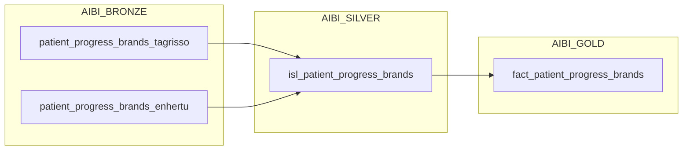

# Task 3: Stored Procedure to dbt Gold 변환 및 구현 상세

본 문서는 `task_3.md`에 정의된 Snowflake Stored Procedure(`SP_GLD_FACT_PATIENT_PROGRES_BRANDS`)를 dbt 아키텍처 및 모범 사례에 맞추어 변환한 내용과 구현 상세를 정리한 문서입니다.

---

## 1. 개요 (Overview)

- **목적**: 기존 명령형/절차적 Snowflake Stored Procedure를 dbt의 선언적 SQL 모델 및 데이터 품질 테스트 구조로 전환
- **대상 원천 데이터 (Silver)**:
  - `DBT_TEST.AIBI_SILVER.isl_patient_progress_brands` (Task 2에서 구현한 Silver Iceberg 테이블)
- **대상 적재 데이터 (Gold)**:
  - `DBT_TEST.AIBI_GOLD.fact_patient_progress_brands` (Iceberg Table 형식)

---

## 2. 주요 변환 비교 (Procedure vs. dbt)

| 항목 | 기존 Stored Procedure (`task_3.md`) | dbt 변환 구현 (`models/gold/`) | 비고 / 개선 효과 |
| :--- | :--- | :--- | :--- |
| **원천 참조 방식** | `COM_AZK_AIBI_WRK.AIBI_SILVER.isl_patient_progres_brands` 하드코딩 | `{{ ref('isl_patient_progress_brands') }}` | dbt DAG 상에서 Silver 모델과의 종속성 및 실행 순서 자동 관리 |
| **테이블 관리 방식** | `INSERT OVERWRITE INTO ...` 절차적 실행 | `dbt_project.yml`의 Gold 설정을 상속받아 `materialized='table'` (Iceberg Table) 자동 생성 | DDL/DML 관리 비용 제거 및 선언적 데이터 파이프라인 수립 |
| **변경 여부 체크 (`_load_dtm`)** | `v_src_load_dtm <= v_tgt_load_dtm`일 경우 실행 SKIP | dbt 파이프라인 실행 시 DAG 순서에 따라 원천 Silver 빌드 후 선언적 재구축 | dbt 오케스트레이션 및 CI/CD 워크플로우에 최적화 |
| **표기 정규화 (`tier`)** | `IFF(LOWER(TRIM(tier)) = 'others', 'Others', tier)` | 동일한 조건식 적용 | 대소문자/공백 오류를 방지하고 BI/대시보드 분석용 데이터 일관성 확보 |
| **신환 수 정수 캐스팅** | `TRUNC(new_pts)::INTEGER AS cnt_new_patients` | 동일한 캐스팅 적용 | 소수점 제거 및 집계/통계용 정수형 메트릭 컬럼으로 전환 |
| **컬럼 정제 (Projection)** | 임시/내부용 컬럼(`year`, `month`, `_file`, `_src_synced` 등) 제외, 10개 비즈니스 컬럼 프로젝션 | 동일하게 10개 분석 컬럼만 최종 노출 | 데이터 마트/소비 레이어(Gold)에 필요한 핵심 데이터만 제공 |
| **데이터 검증 및 예외 처리** | `RAISE empty_source` 등 프로시저 내 예외 발생 | `fact_patient_progress_brands.yml`에 `not_null` 테스트 슈트 구성 | 데이터 품질 검증 자동화 |

---

## 3. 파일별 구현 상세

### 3.1. dbt SQL 모델: `com-azk-it-snowflake/models/gold/fact_patient_progress_brands.sql`

#### 구조 및 CTE 흐름
1. **`silver_source`**: `{{ ref('isl_patient_progress_brands') }}`를 통해 Silver 레이어의 정제된 데이터를 읽어옴
2. **최종 `SELECT`**: 
   - `tier` 표기 통일 (`others` -> `Others`)
   - `new_pts` -> `cnt_new_patients` (정수형)
   - `_load_dtm` 신규 적재 시점(KST) 부여
   - 비즈니스 요구사항에 맞는 10개 핵심 컬럼 선택

```sql
{{ config(
    materialized='table'
) }}

WITH silver_source AS (
    SELECT * FROM {{ ref('isl_patient_progress_brands') }}
)

SELECT
    base_month,
    brand_name,
    hca,
    -- 'others' 표기 통일 (대소문자·공백 차이 포함)
    IFF(LOWER(TRIM(tier)) = 'others', 'Others', tier)                   AS tier,
    indication,
    sub_indication,
    business_unit,
    therapy_area,
    TRUNC(new_pts)::INTEGER                                             AS cnt_new_patients,
    CONVERT_TIMEZONE('UTC', 'Asia/Seoul', SYSDATE())::TIMESTAMP_NTZ(6) AS _load_dtm
FROM silver_source
```

---

### 3.2. dbt 스키마 및 테스트: `com-azk-it-snowflake/models/gold/fact_patient_progress_brands.yml`

- **문서화**: 테이블 및 모든 컬럼에 대해 명확한 국문 설명을 제공하여 BI 사용자 및 분석가가 직관적으로 이해할 수 있도록 구성
- **품질 검증 테스트**:
  - `base_month`: `not_null` (분석 기준월 무결성)
  - `brand_name`: `not_null` (브랜드 식별값 무결성)
  - `cnt_new_patients`: `not_null` (환자 수 지표 무결성)
  - `_load_dtm`: `not_null` (적재 메타데이터 무결성)

```yaml
version: 2

models:
  - name: fact_patient_progress_brands
    description: "Tagrisso 및 Enhertu 브랜드 신환 진행 현황(Patient Progress) 최종 Gold 팩트 테이블 (Row grain 유지, 무집계)"
    columns:
      - name: base_month
        description: "연도와 월을 파싱하여 생성된 기준월 (해당 월의 1일자)"
        tests:
          - not_null
      - name: brand_name
        description: "의약품 브랜드명 (Enhertu, Tagrisso 등)"
        tests:
          - not_null
      - name: hca
        description: "병원명 (Healthcare Agency / Hospital)"
      - name: tier
        description: "병원 티어 등급 (Others 표기 표준화 적용: Top5, Top10, Top20, Top30, Others 등)"
      - name: indication
        description: "적응증"
      - name: sub_indication
        description: "세부 적응증"
      - name: business_unit
        description: "사업부 (예: Oncology)"
      - name: therapy_area
        description: "치료 영역 (Therapy Area)"
      - name: cnt_new_patients
        description: "신환 수 정수값 (TRUNC(new_pts)::INTEGER)"
        tests:
          - not_null
      - name: _load_dtm
        description: "Gold 테이블 적재 일시 (KST/Asia/Seoul 기준)"
        tests:
          - not_null
```

---

## 4. 전체 리니지 파이프라인 (Bronze → Silver → Gold)



- **Bronze → Silver**: 두 브랜드 원천 소스 병합(`UNION ALL`), `GET_IGNORE_CASE` 파싱, `base_month` 생성, 최신 동기화 일시(`_src_synced`) 기록
- **Silver → Gold**: 행 단위 보존(No Aggregation), `tier` 정규화, `cnt_new_patients` 산출, 대시보드 서빙용 최종 Iceberg 팩트 테이블 구축
